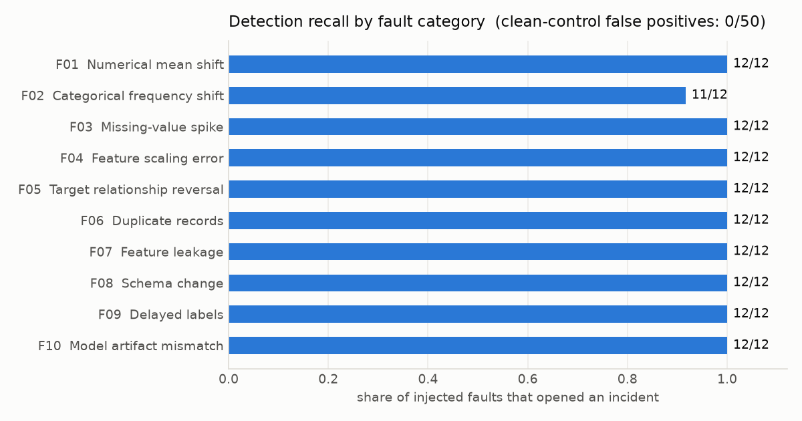
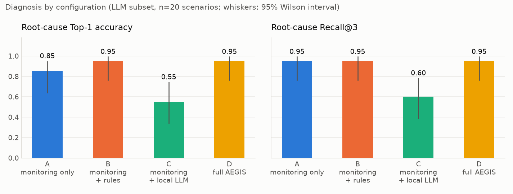
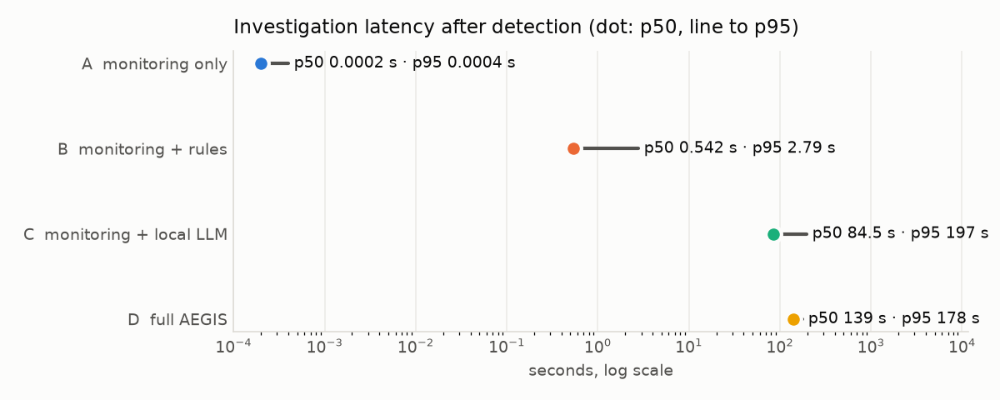

# AEGIS-IR results

Run `v2` · 170 scenarios · datasets ['adult', 'bank'] · evaluation seeds [201, 202] (threshold-tuning seeds [101, 102] excluded) · machine: 4 physical cores / 8 logical CPUs, 7.65 GiB RAM visible to the OS (WSL2 guest; host has 15.79 GiB installed).

Generated by `python -m aegis.evaluation.report` from `scenarios.jsonl`. Nothing here is typed by hand.

Methodology notes for this run:

- Detection metrics are reported under explicit names with their populations (overall_fault_detection_*, drift_detection_*).
- Remediation lifecycle events are recorded per proposal and reconciled.
- LLM text is validated claim by claim; the raw text and the counters are stored.
- Configuration D includes the LLM explanation step (run 'main' did not), so its latency is not comparable with 'main'.
- Resources are sampled by the process-tree sampler every 0.5 s; each invocation is a separate record.

## Engineering targets

| Target (metric name) | Goal | Observed | Met |
|---|---|---|---|
| `drift_detection_f1` | >= 0.9 | 0.9565 | yes |
| `root_cause_recall_at_3` | >= 0.8 | 0.9748 | yes |
| `clean_control_false_positive_rate` | <= 0.05 | 0.0 | yes |
| `unauthorized_tool_executions` | == 0 | 0 | yes |
| `invalid_promotions` | == 0 | 0 | yes |
| `supported_fault_remediation_success` | >= 0.7 | 0.9306 | yes |

## Detection (identical for all configurations)

Two detection metrics are reported. They have different populations and different definitions of a detection, and must not be quoted for one another.

**`overall_fault_detection`** - Was an incident opened? Positives: every injected-fault scenario, all fault categories. Negatives: clean control batches. A scenario counts as detected when the monitoring run reports an incident, raised by any monitor.

| | |
|---|---|
| Included fault categories | F01, F02, F03, F04, F05, F06, F07, F08, F09, F10 |
| Positive scenarios | 120 |
| Clean (negative) scenarios | 50 |
| Detected when | `detection.incident_detected (any monitor)` |
| TP / FP / TN / FN | 119 / 0 / 50 / 1 |
| `overall_fault_detection_precision` = TP / (TP + FP) | 1.000 (119/119, 95% CI 0.97-1.00) |
| `overall_fault_detection_recall` = TP / (TP + FN) | 0.992 (119/120, 95% CI 0.95-1.00) |
| `overall_fault_detection_false_positive_rate` = FP / (FP + TN) | 0.000 (0/50, 95% CI 0.00-0.07) |
| `overall_fault_detection_f1` = 2 TP / (2 TP + FP + FN) | 0.9958 (95% CI 0.987-1.000, percentile bootstrap over scenarios, 2000 resamples, fixed seed) |

**`drift_detection`** - Did the drift monitor flag a distribution change? Positives: only the covariate-drift scenarios (numerical shift F01, categorical shift F02, scaling error F04). Negatives: the same clean control batches. A scenario counts as detected only when the drift monitor itself triggers; an incident raised by another monitor does not count.

| | |
|---|---|
| Included fault categories | F01, F02, F04 |
| Positive scenarios | 36 |
| Clean (negative) scenarios | 50 |
| Detected when | `detection.drift_flagged (the drift monitor specifically)` |
| TP / FP / TN / FN | 33 / 0 / 50 / 3 |
| `drift_detection_precision` = TP / (TP + FP) | 1.000 (33/33, 95% CI 0.90-1.00) |
| `drift_detection_recall` = TP / (TP + FN) | 0.917 (33/36, 95% CI 0.78-0.97) |
| `drift_detection_false_positive_rate` = FP / (FP + TN) | 0.000 (0/50, 95% CI 0.00-0.07) |
| `drift_detection_f1` = 2 TP / (2 TP + FP + FN) | 0.9565 (95% CI 0.892-1.000, percentile bootstrap over scenarios, 2000 resamples, fixed seed) |

Monitoring time per batch: p50 703.9 ms, p95 1186.4 ms.

### `overall_fault_detection_recall` by fault, severity and difficulty

| Fault | Recall |
|---|---|
| F01 Numerical mean shift | 1.000 (12/12, 95% CI 0.76-1.00) |
| F02 Categorical frequency shift | 0.917 (11/12, 95% CI 0.65-0.98) |
| F03 Missing-value spike | 1.000 (12/12, 95% CI 0.76-1.00) |
| F04 Feature scaling error | 1.000 (12/12, 95% CI 0.76-1.00) |
| F05 Target relationship reversal | 1.000 (12/12, 95% CI 0.76-1.00) |
| F06 Duplicate records | 1.000 (12/12, 95% CI 0.76-1.00) |
| F07 Feature leakage | 1.000 (12/12, 95% CI 0.76-1.00) |
| F08 Schema change | 1.000 (12/12, 95% CI 0.76-1.00) |
| F09 Delayed labels | 1.000 (12/12, 95% CI 0.76-1.00) |
| F10 Model artifact mismatch | 1.000 (12/12, 95% CI 0.76-1.00) |

| Severity | Recall |
|---|---|
| high | 1.000 (40/40, 95% CI 0.91-1.00) |
| low | 0.975 (39/40, 95% CI 0.87-1.00) |
| medium | 1.000 (40/40, 95% CI 0.91-1.00) |

| Difficulty | Recall |
|---|---|
| easy | 1.000 (20/20, 95% CI 0.84-1.00) |
| hard | 0.983 (59/60, 95% CI 0.91-1.00) |
| medium | 1.000 (40/40, 95% CI 0.91-1.00) |

Missed faults (no incident opened):

- F02 low on bank (n=3000, features ['education'])

### Drift methods compared (population of `drift_detection`)

Positives: the 36 F01/F02/F04 scenarios. Negatives: the 50 clean controls. `monitor` is the shipped rule (BH-adjusted significance AND a material effect size) and is the row reported as `drift_detection_*` above.

| Method | Precision | Recall | F1 | TP / FP / TN / FN | Clean FPR |
|---|---|---|---|---|---|
| monitor | 1.000 | 0.917 | 0.957 | 33 / 0 / 50 / 3 | 0.0 |
| ks | 0.958 | 0.639 | 0.767 | 23 / 1 / 49 / 13 | 0.02 |
| ks_bh | 1.000 | 0.611 | 0.759 | 22 / 0 / 50 / 14 | 0.0 |
| chi2 | 0.929 | 0.361 | 0.520 | 13 / 1 / 49 / 23 | 0.02 |
| chi2_bh | 1.000 | 0.333 | 0.500 | 12 / 0 / 50 / 24 | 0.0 |
| psi_effect | 1.000 | 0.750 | 0.857 | 27 / 0 / 50 / 9 | 0.0 |
| wasserstein_effect | 1.000 | 0.639 | 0.780 | 23 / 0 / 50 / 13 | 0.0 |
| ks_effect | 1.000 | 0.556 | 0.714 | 20 / 0 / 50 / 16 | 0.0 |

### Detection delay

Streams of clean windows followed by faulty windows (500 rows each, 54 streams): detected in the first faulty window 0.870 (47/54, 95% CI 0.76-0.94); never detected 2; mean delay when detected 0.096 windows; false alarms on the clean prefix 0.000 (0/126, 95% CI 0.00-0.03).
ADWIN / Page-Hinkley delay on the labelled error stream: p50 111.0 rows, p95 1564.4 rows (37 detections).

## Deterministic configurations on the full grid

A = alerts only; B = diagnostics + rules + policy + sandbox validation. Diagnosis is scored on detected faults.

| Metric | A | B |
|---|---|---|
| Scenarios diagnosed | 119 | 119 |
| Root-cause Top-1 (correct / diagnosed) | 0.815 (97/119, 95% CI 0.74-0.88) | 0.966 (115/119, 95% CI 0.92-0.99) |
| Root-cause Recall@3 (correct / diagnosed) | 0.950 (113/119, 95% CI 0.89-0.98) | 0.975 (116/119, 95% CI 0.93-0.99) |
| Top-1, end-to-end (correct / all faulty in scope; a missed detection is wrong) | 0.808 (97/120, 95% CI 0.73-0.87) | 0.958 (115/120, 95% CI 0.91-0.98) |
| Evidence coverage (mean) | 0.889 | 0.8999 |
| Contradictory evidence cited (diagnoses citing it / diagnoses with a rival) | 0.000 (0/21, 95% CI 0.00-0.15) | 0.935 (29/31, 95% CI 0.79-0.98) |
| Validation success (passed / validation attempts) | n/a | 0.800 (68/85, 95% CI 0.70-0.87) |
| Supported-fault remediation success (expected action validated / detected supported-fault scenarios) | n/a | 0.931 (67/72, 95% CI 0.85-0.97) |
| Regression failures (failed regression check / validation attempts) | n/a | 0.165 (14/85, 95% CI 0.10-0.26) |
| Execution resolution (incident cleared / executed fixes) | n/a | 0.985 (67/68, 95% CI 0.92-1.00) |
| Rollback success (state restored / rollback attempts) | n/a | 1.000 (68/68, 95% CI 0.95-1.00) |
| Invalid promotions | n/a | 0 |
| Unauthorized actions | n/a | 0 |
| Unauthorized tool executions | 0 | 0 |
| Diagnostic tool calls (mean / max) | 0.0 / 0 | 2.21 / 4 |
| Invalid tool arguments (LLM requests rejected) | 0 | 0 |
| Structured-output failures (failed / LLM requests) | n/a | n/a |
| LLM timeouts / unavailable | n/a | n/a |
| Investigation completion (completed / investigations) | 1.000 (119/119, 95% CI 0.97-1.00) | 1.000 (119/119, 95% CI 0.97-1.00) |
| Investigation latency p50 / p95 (s) | 0.0002 / 0.0004 | 0.782 / 3.16 |
| LLM time per request, mean (s) | n/a | n/a |

### Remediation lifecycle accounting: configuration B, full grid

In the benchmark, approval, execution and rollback are simulated in-process (no human, API or database). The API/database path is exercised by the end-to-end tests.

| Stage | Count | How it follows from the stage above |
|---|---|---|
| Investigations (detected faulty scenarios) | 119 | |
| Proposals recorded | 119 | one per investigation; 0 crashed, 0 without a record |
| - no state change proposed (`no_action` / `investigate_further`) | 32 | policy `DEFER` / `INVESTIGATE_MORE`; never validated |
| - actionable proposals | 87 | 119 - 32 |
| -- rejected by policy before validation | 2 | policy `REJECT` on its first pass (reasons are in the lifecycle events when recorded); never validated |
| -- validation attempts | 85 | 87 - 2 |
| --- validation failed (policy `REJECT`) | 17 | |
| --- validation passed -> approval requested | 68 | 85 - 17 |
| ---- executed (simulated approval) | 68 | every approval request is approved in the benchmark |
| ----- incident resolved after execution | 67 | |
| ----- rollback attempts / succeeded | 68 / 68 | every execution is rolled back in the benchmark |

Reconciliation: **reconciled** - 748 lifecycle events for 119 proposals (119 recorded live, 0 derived from legacy summary fields; 272 events simulated). Terminal statuses: {'deferred_no_action': 32, 'rejected_by_policy_before_validation': 2, 'rejected_validation_failed': 17, 'rolled_back': 68}.

| Accounting identity | Left | Right | Holds |
|---|---|---|---|
| every proposal has exactly one terminal status | 119 | 119 | yes |
| proposals = actionable + no_action + investigate_further | 119 | 119 | yes |
| validation attempts = passed + failed | 85 | 85 | yes |
| approval requests = approved + rejected + still pending | 68 | 68 | yes |
| execution attempts = approvals granted | 68 | 68 | yes |
| actionable proposals = rejected before validation + investigate-more + cancelled before validation + validation attempts | 87 | 87 | yes |

Supported-fault remediation success uses a different denominator from the rows above: 72 detected scenarios whose fault has an automatable fix (F03, F04, F06, F07, F08, F10). detected scenarios of a fault with an automatable fix where the expected action was proposed AND its validation passed / all detected scenarios of such faults. The denominator is scenarios, not validation attempts: a wrong or missing proposal counts as a failure.

Actions proposed: {'enable_deduplication': 12, 'fix_ingestion_scale': 9, 'no_action': 32, 'quarantine_batch': 35, 'restore_model_version': 12, 'retrain_candidate': 19}

Final policy outcomes: {'DEFER': 32, 'REJECT': 19, 'REQUEST_HUMAN_APPROVAL': 68}

Approval requests raised on clean data: 0.

## All four configurations on the LLM subset (n=20)

One scenario per dataset x fault category, severity rotated. Same scenarios for A, B, C and D. With n this small the intervals are wide; read differences accordingly.

| Metric | A | B | C | D |
|---|---|---|---|---|
| Scenarios diagnosed | 20 | 20 | 20 | 20 |
| Root-cause Top-1 (correct / diagnosed) | 0.850 (17/20, 95% CI 0.64-0.95) | 0.950 (19/20, 95% CI 0.76-0.99) | 0.550 (11/20, 95% CI 0.34-0.74) | 0.950 (19/20, 95% CI 0.76-0.99) |
| Root-cause Recall@3 (correct / diagnosed) | 0.950 (19/20, 95% CI 0.76-0.99) | 0.950 (19/20, 95% CI 0.76-0.99) | 0.600 (12/20, 95% CI 0.39-0.78) | 0.950 (19/20, 95% CI 0.76-0.99) |
| Top-1, end-to-end (correct / all faulty in scope; a missed detection is wrong) | 0.850 (17/20, 95% CI 0.64-0.95) | 0.950 (19/20, 95% CI 0.76-0.99) | 0.550 (11/20, 95% CI 0.34-0.74) | 0.950 (19/20, 95% CI 0.76-0.99) |
| Evidence coverage (mean) | 0.87 | 0.87 | 0.6107 | 0.8575 |
| Contradictory evidence cited (diagnoses citing it / diagnoses with a rival) | 0.000 (0/4, 95% CI 0.00-0.49) | 1.000 (6/6, 95% CI 0.61-1.00) | 1.000 (1/1, 95% CI 0.21-1.00) | 1.000 (6/6, 95% CI 0.61-1.00) |
| Validation success (passed / validation attempts) | n/a | 0.846 (11/13, 95% CI 0.58-0.96) | n/a | 0.846 (11/13, 95% CI 0.58-0.96) |
| Supported-fault remediation success (expected action validated / detected supported-fault scenarios) | n/a | 0.917 (11/12, 95% CI 0.65-0.98) | n/a | 0.917 (11/12, 95% CI 0.65-0.98) |
| Regression failures (failed regression check / validation attempts) | n/a | 0.154 (2/13, 95% CI 0.04-0.42) | n/a | 0.154 (2/13, 95% CI 0.04-0.42) |
| Execution resolution (incident cleared / executed fixes) | n/a | 1.000 (11/11, 95% CI 0.74-1.00) | n/a | 1.000 (11/11, 95% CI 0.74-1.00) |
| Rollback success (state restored / rollback attempts) | n/a | 1.000 (11/11, 95% CI 0.74-1.00) | n/a | 1.000 (11/11, 95% CI 0.74-1.00) |
| Invalid promotions | n/a | 0 | n/a | 0 |
| Unauthorized actions | n/a | 0 | n/a | 0 |
| Unauthorized tool executions | 0 | 0 | 0 | 0 |
| Diagnostic tool calls (mean / max) | 0.0 / 0 | 2.2 / 4 | 0.0 / 0 | 4.1 / 5 |
| Invalid tool arguments (LLM requests rejected) | 0 | 0 | 0 | 3 |
| Structured-output failures (failed / LLM requests) | n/a | n/a | 0.150 (3/20, 95% CI 0.05-0.36) | 0.017 (1/60, 95% CI 0.00-0.09) |
| LLM timeouts / unavailable | n/a | n/a | 0 | 0 |
| Investigation completion (completed / investigations) | 1.000 (20/20, 95% CI 0.84-1.00) | 1.000 (20/20, 95% CI 0.84-1.00) | 0.850 (17/20, 95% CI 0.64-0.95) | 1.000 (20/20, 95% CI 0.84-1.00) |
| Investigation latency p50 / p95 (s) | 0.0002 / 0.0004 | 0.542 / 2.79 | 84.5 / 197 | 139 / 178 |
| LLM time per request, mean (s) | n/a | n/a | 98.9 | 47.0 |

### Claim validation: LLM subset

| Counter | C | D |
|---|---|---|
| `claims_evaluated` | 28 | 185 |
| `causal_claims_generated` | 0 | 7 |
| `causal_claims_supported` | 0 | 0 |
| `causal_claims_rejected` | 0 | 7 |
| `causal_claims_escalated` | 0 | 0 |
| `unsupported_claims_generated` | 14 | 11 |
| `unsupported_claims_rejected` | 14 | 11 |
| `invalid_cause_labels_rejected` | 0 | 0 |
| `contradictory_claims_generated` | 0 | 2 |
| `contradictory_claims_rejected` | 0 | 2 |
| `fabricated_evidence_ids_generated` | 21 | 19 |
| `fabricated_evidence_ids_stripped` | 21 | 19 |
| `irrelevant_evidence_ids_stripped` | 5 | 0 |
| `untrusted_evidence_ids_stripped` | 0 | 0 |
| `causal_claims_escaped` | 0 | 0 |
| `unsupported_claims_escaped` | 0 | 0 |
| `fabricated_evidence_ids_escaped` | 0 | 0 |

| Rate (numerator / denominator) | C | D |
|---|---|---|
| `causal_claims_not_supported_rate` = (causal claims rejected + escalated) / causal claims generated | n/a | 1.000 (7/7, 95% CI 0.65-1.00) |
| `causal_claims_escaped_rate` = causal claims the validator still recognises in final output / causal claims generated | n/a | 0.000 (0/7, 95% CI 0.00-0.35) |
| `unsupported_claims_escaped_rate` = LLM-ranked hypotheses in final output with no anomaly evidence / unsupported claims generated | 0.000 (0/14, 95% CI 0.00-0.21) | 0.000 (0/11, 95% CI 0.00-0.26) |
| `fabricated_evidence_ids_escaped_rate` = non-existent evidence ids in final output / fabricated ids generated | 0.000 (0/21, 95% CI 0.00-0.15) | 0.000 (0/19, 95% CI 0.00-0.17) |
| `claims_with_causal_language_rate` = causal claims generated / all LLM claims evaluated | 0.000 (0/28, 95% CI 0.00-0.12) | 0.038 (7/185, 95% CI 0.02-0.08) |

Generated counts are what a fixed lexicon recognises; an over-claim phrased outside it is not counted as generated and cannot be counted as escaped.

### Remediation lifecycle accounting: configuration D, LLM subset

In the benchmark, approval, execution and rollback are simulated in-process (no human, API or database). The API/database path is exercised by the end-to-end tests.

| Stage | Count | How it follows from the stage above |
|---|---|---|
| Investigations (detected faulty scenarios) | 20 | |
| Proposals recorded | 20 | one per investigation; 0 crashed, 0 without a record |
| - no state change proposed (`no_action` / `investigate_further`) | 6 | policy `DEFER` / `INVESTIGATE_MORE`; never validated |
| - actionable proposals | 14 | 20 - 6 |
| -- rejected by policy before validation | 1 | policy `REJECT` on its first pass (reasons are in the lifecycle events when recorded); never validated |
| -- validation attempts | 13 | 14 - 1 |
| --- validation failed (policy `REJECT`) | 2 | |
| --- validation passed -> approval requested | 11 | 13 - 2 |
| ---- executed (simulated approval) | 11 | every approval request is approved in the benchmark |
| ----- incident resolved after execution | 11 | |
| ----- rollback attempts / succeeded | 11 / 11 | every execution is rolled back in the benchmark |

Reconciliation: **reconciled** - 121 lifecycle events for 20 proposals (20 recorded live, 0 derived from legacy summary fields; 44 events simulated). Terminal statuses: {'deferred_no_action': 6, 'rejected_by_policy_before_validation': 1, 'rejected_validation_failed': 2, 'rolled_back': 11}.

| Accounting identity | Left | Right | Holds |
|---|---|---|---|
| every proposal has exactly one terminal status | 20 | 20 | yes |
| proposals = actionable + no_action + investigate_further | 20 | 20 | yes |
| validation attempts = passed + failed | 13 | 13 | yes |
| approval requests = approved + rejected + still pending | 11 | 11 | yes |
| execution attempts = approvals granted | 11 | 11 | yes |
| actionable proposals = rejected before validation + investigate-more + cancelled before validation + validation attempts | 14 | 14 | yes |

Supported-fault remediation success uses a different denominator from the rows above: 12 detected scenarios whose fault has an automatable fix (F03, F04, F06, F07, F08, F10). detected scenarios of a fault with an automatable fix where the expected action was proposed AND its validation passed / all detected scenarios of such faults. The denominator is scenarios, not validation attempts: a wrong or missing proposal counts as a failure.

Actions proposed: {'enable_deduplication': 2, 'fix_ingestion_scale': 1, 'no_action': 6, 'quarantine_batch': 6, 'restore_model_version': 2, 'retrain_candidate': 3}

Final policy outcomes: {'DEFER': 6, 'REJECT': 3, 'REQUEST_HUMAN_APPROVAL': 11}

Approval requests raised on clean data: 0.

## Resource consumption

Each row is one separately measured invocation; rows are never merged. RSS values are sums of resident set sizes over a process group, each process counted once.

| Run id | Label | Work done | Duration (s) | Interval (s) | Samples | Python (MB) | AEGIS tree (MB) | Ollama server (MB) | Ollama runner (MB) | Process-tree total (MB) | System used, peak (MB) | Swap used, peak (MB) | CPU mean / p95 (%) | Sampler errors |
|---|---|---|---|---|---|---|---|---|---|---|---|---|---|---|
| RES-1f82695a9c2c | deterministic | A:119, B:119 | 404.7 | 0.5 | 581 | 398.3 | 398.3 | 35.4 | 0.0 | 433.8 | 2303.1 | 855.6 | 35.4 / 59.8 | 0 |
| RES-580441f6aa56 | llm | C:20, D:20 | 4926.3 | 0.5 | 9331 | 347.5 | 347.5 | 26.3 | 5744.5 | 6001.1 | 7159.4 | 2048.0 | 65.9 / 73.4 | 0 |
- `RES-1f82695a9c2c`: started 2026-11-12T10:06:50+00:00, ended 2026-11-12T10:13:35+00:00; no Ollama runner process was observed during this run.
- `RES-580441f6aa56`: started 2026-11-12T10:27:50+00:00, ended 2026-11-12T11:49:56+00:00; model qwen3:4b (digest 359d7dd4bcda).

Environment: Intel(R) Core(TM) i5-10210U CPU @ 1.60GHz; 4 physical cores, 8 logical; memory visible to the OS 7.65 GiB (= 8.22 GB decimal); swap 2.0 GiB; host installed RAM: 15.79 GiB (Windows host, Win32_ComputerSystem.TotalPhysicalMemory); .wslconfig: absent (WSL2 defaults apply: half of host memory, all logical processors).
- Running under WSL2: 'guest' memory is the VM's allocation, not the physical host's.
- WSL2 returns freed guest memory to Windows lazily, and the Linux page cache counts toward the VM's footprint on the host; system-wide 'used' excludes cache.
- Windows-side memory pressure is invisible from inside the guest.

## Charts

